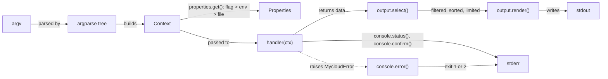
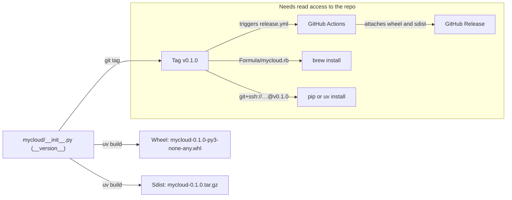

# How to Build a CLI People Enjoy Using

## Overview

`mycloud` is a small, working command-line tool for a pretend cloud. It exists to teach one thing: **how to design and build a good CLI**. We modelled it on Google's `gcloud`, one of the most consistent large CLIs around. It's about 600 lines of standard-library Python, and every design rule in this README points to the code that implements it.

The "cloud" is a JSON file on your machine, so you can create, list, and delete things freely. Nothing leaves your laptop.

```console
$ mycloud config set project demo-project
Updated property [core/project].

$ mycloud compute instances create web-1 web-2 --zone=us-east1-b --labels=env=dev
Created [https://mycloud.example.com/v1/projects/demo-project/zones/us-east1-b/instances/web-1].
Created [https://mycloud.example.com/v1/projects/demo-project/zones/us-east1-b/instances/web-2].
NAME   ZONE        MACHINE_TYPE  STATUS
web-1  us-east1-b  e2-small      RUNNING
web-2  us-east1-b  e2-small      RUNNING

$ mycloud compute instances list --filter='name~^web' --format='value(name)'
web-1
web-2
```

## Contents

- [Quick start](#quick-start)
- [Installation](#installation): pip, uv, and Homebrew, for anyone with access to the repo.
- [Use mycloud](#use-mycloud): a walkthrough of every command with real output.
- [The CLI Constitution](#the-cli-constitution): 12 design rules learned from `gcloud`.
- [Command reference](#command-reference)
- [How the code is organized](#how-the-code-is-organized)
- [Add a new command](#add-a-new-command): a tutorial that applies the rules.
- [Development](#development)
- [How mycloud is built and distributed](#how-mycloud-is-built-and-distributed)
- [Where mycloud is simpler than gcloud](#where-mycloud-is-simpler-than-gcloud)
- [What's next](#whats-next)
- [License](#license)

## Quick Start

Install it with whichever tool you already use (see [Installation](#installation) for every option):

```bash
# uv (recommended): installs into its own isolated environment, puts `mycloud` on your PATH
uv tool install "git+ssh://git@github.com/kavisek/demo-cli-creation.git"

# pip, inside a virtualenv you manage
pip install "git+ssh://git@github.com/kavisek/demo-cli-creation.git"

# Homebrew
brew tap kavisek/demo-cli-creation git@github.com:kavisek/demo-cli-creation.git
brew install kavisek/demo-cli-creation/mycloud

mycloud version
```

Or work on it from source. You need [uv](https://docs.astral.sh/uv/) and Python 3.11 or newer:

```bash
git clone git@github.com:kavisek/demo-cli-creation.git && cd demo-cli-creation
make sync                                  # create .venv and install dev tools
make run ARGS="--help"                     # run the CLI from source
make run ARGS="compute instances list"
```

State lives in `~/.config/mycloud/`. Set `MYCLOUD_CONFIG=/some/dir` to use a throwaway directory instead (the tests do this).

## Installation

mycloud is a normal Python package (`mycloud`) that installs a command called `mycloud`. **It isn't published to PyPI.** You install it straight from the GitHub repo, so anyone who can read the repo can install it, and nobody else can. There are no tokens or package indexes to manage: GitHub access *is* the access control. It has no runtime dependencies, so every method in this section installs one package. Pick the row that matches your situation:

| If you want | Use |
| --- | --- |
| A command on your PATH, isolated from other Python projects | `uv tool install` (or `pipx install`) |
| To run it once without installing | `uvx` |
| It inside an existing virtualenv or project | `pip install` / `uv pip install` / `uv add` |
| To manage it with your other Mac tools | Homebrew |
| To change the code | [Install from source](#install-from-source) |

### Install from the GitHub Repo Over SSH

Use git URLs that start with `git+ssh://`. pip and uv shell out to `git`, which authenticates with the SSH key you already use for `git clone`. If you can clone the repo, you can install the CLI. To check that your key works, run the following:

```console
$ ssh -T git@github.com
Hi <your-user>! You've successfully authenticated, but GitHub does not provide shell access.
```

#### uv

```bash
# Install as a standalone tool (recommended). Creates ~/.local/bin/mycloud
uv tool install "git+ssh://git@github.com/kavisek/demo-cli-creation.git"

# Pin a release tag (recommended for teams), a branch, or a commit
uv tool install "git+ssh://git@github.com/kavisek/demo-cli-creation.git@v0.1.0"
uv tool install "git+ssh://git@github.com/kavisek/demo-cli-creation.git@main"

# Run once without installing (cached after the first run)
uvx --from "git+ssh://git@github.com/kavisek/demo-cli-creation.git@v0.1.0" mycloud version

# Add it as a dependency of another uv project (recorded in pyproject.toml + uv.lock)
uv add "mycloud @ git+ssh://git@github.com/kavisek/demo-cli-creation.git@v0.1.0"

# Install into the active virtualenv
uv pip install "git+ssh://git@github.com/kavisek/demo-cli-creation.git@v0.1.0"
```

If `~/.local/bin` isn't on your PATH, run `uv tool update-shell` once.

#### pip

```bash
python3 -m venv .venv && source .venv/bin/activate
pip install "git+ssh://git@github.com/kavisek/demo-cli-creation.git@v0.1.0"

# In a requirements.txt
mycloud @ git+ssh://git@github.com/kavisek/demo-cli-creation.git@v0.1.0

# pipx is the pip-world equivalent of `uv tool install`
pipx install "git+ssh://git@github.com/kavisek/demo-cli-creation.git@v0.1.0"
```

> **Note:** pip and uv need `git+ssh://git@github.com/OWNER/REPO.git` (with a `/` after the host). The `git@github.com:OWNER/REPO.git` form you paste into `git clone` uses a `:` and only works for git and Homebrew.

#### Homebrew

The repo is its own tap: Homebrew reads [`Formula/mycloud.rb`](Formula/mycloud.rb) from the repo, and the formula clones the source over SSH too. Pass the SSH URL as the second argument to `brew tap`:

```bash
brew tap kavisek/demo-cli-creation git@github.com:kavisek/demo-cli-creation.git
brew install kavisek/demo-cli-creation/mycloud
```

> **Caution:** Always use the full name `kavisek/demo-cli-creation/mycloud`. Homebrew's built-in casks already include an unrelated app called `mycloud` (the WD My Cloud desktop installer), and a bare `brew install mycloud` installs that cask instead of this CLI. If that happens, remove it with `brew uninstall --cask mycloud`.

Without the URL, `brew tap kavisek/demo-cli-creation` guesses a repo called `homebrew-demo-cli-creation` over HTTPS, which doesn't exist (and couldn't be read if it did), and fails with `fatal: could not read Username for 'https://github.com'`. If that happened, `brew untap kavisek/demo-cli-creation` and tap again with the URL.

Recent Homebrew versions refuse to load formulae from third-party taps until you trust them. If you see `Refusing to load formula ... from untrusted tap`, run:

```bash
brew trust kavisek/demo-cli-creation
```

`brew install --HEAD kavisek/demo-cli-creation/mycloud` builds from the latest `main` instead of the tagged release.

### Install from a GitHub Release

Every release tag also publishes the built wheel as a GitHub Release asset (see [Release with GitHub Actions](#release-with-github-actions)). With the [GitHub CLI](https://cli.github.com/) signed in to an account that can read the repo, download it and install the file:

```bash
gh release download v0.1.0 --repo kavisek/demo-cli-creation --pattern '*.whl'
uv tool install ./mycloud-0.1.0-py3-none-any.whl      # or: pip install ./mycloud-0.1.0-py3-none-any.whl
```

This doesn't need `git` or a build step on the user's machine. Use it for CI images and machines that can't use SSH.

### Install from Source

```bash
git clone git@github.com:kavisek/demo-cli-creation.git && cd demo-cli-creation
make sync          # dev environment in .venv; run with `make run ARGS="..."` or `uv run mycloud`
make install       # or put your working copy on your PATH: uv tool install --force --reinstall .
```

You can also run `pip install -e .` in a virtualenv (an editable install, so code changes apply without reinstalling).

### Upgrade, Check, and Uninstall

| Installed with | Upgrade | Uninstall |
| --- | --- | --- |
| `uv tool install` | `uv tool upgrade mycloud` (re-run install with a new `@tag` if you pinned one) | `uv tool uninstall mycloud` |
| `pipx install` | `pipx upgrade mycloud` | `pipx uninstall mycloud` |
| `pip install` | `pip install --upgrade "<same URL with the new @tag>"` | `pip uninstall mycloud` |
| Homebrew | `brew update && brew upgrade kavisek/demo-cli-creation/mycloud` | `brew uninstall kavisek/demo-cli-creation/mycloud && brew untap kavisek/demo-cli-creation` |

Confirm what's on your PATH with `mycloud version` and `which -a mycloud`. If two install methods both put an `mycloud` on your PATH, the first one in `which -a` wins. Remove the one you don't want.

## Use mycloud

This section walks through a whole session, from an empty config to cleaning up. All output in this section is real, copied from a run. Only IDs and timestamps differ on your machine.

> **Note:** In the examples, lines that start with `Created [`, `Updated [`, `Deleted [`, `Listed 0 items.`, `ERROR:`, or a prompt go to **stderr**. Everything else is **stdout**, the data you can pipe or save. See [Article 7](#article-7-stdout-is-for-data-stderr-is-for-people).

### Get Help at Any Level

Every node in the tree answers `--help`: `mycloud --help`, `mycloud compute --help`, `mycloud compute instances --help`, and `mycloud compute instances create --help`.

```console
$ mycloud compute instances --help
usage: mycloud compute instances [-h] [--project PROJECT_ID] [--format FORMAT]
                                 [--quiet]
                                 [--verbosity {debug,info,warning,error,none}]
                                 COMMAND ...

Create, inspect, and delete instances.

global flags:
  --project PROJECT_ID  Project to act on. Overrides the core/project
                        property.
  --format FORMAT       Output format: table, json, yaml, csv, value; add
                        fields to pick columns, e.g. 'table(name,status)'.
  --quiet, -q           Never prompt; answer yes to confirmations.
  --verbosity {debug,info,warning,error,none}
                        Minimum level of log messages printed to stderr
                        (default: warning).

commands:
  COMMAND
    list                List instances in the project.
    describe            Show every field of one instance.
    create              Create one or more instances.
    delete              Delete one or more instances.
    start               Start one or more instances.
    stop                Stop one or more instances.
```

Leaf commands end with an `EXAMPLES` section you can copy from:

```console
$ mycloud compute instances delete --help
...
EXAMPLES
  $ mycloud compute instances delete web-1 web-2 --zone=us-east1-b
```

### Check the Installation

```console
$ mycloud version
mycloud 0.1.0

$ mycloud info
configDir: /Users/you/.config/mycloud
platform: darwin
properties: {}
python: "3.13.13"
version: "0.1.0"
```

### Set Default Properties

Most commands need a project, and `compute instances` commands need a zone. Until you set them, the error message tells you how:

```console
$ mycloud compute instances list
ERROR: (mycloud.compute.instances.list) The required property [core/project] is not currently set. To fix this, pass --project, set MYCLOUD_CORE_PROJECT, or run:
  $ mycloud config set core/project VALUE
```

Save them once with `config set`. A bare name such as `project` is shorthand for `core/project`.

```console
$ mycloud config set project demo-project
Updated property [core/project].

$ mycloud config set compute/zone us-east1-b
Updated property [compute/zone].

$ mycloud config get project
demo-project

$ mycloud config get core/disable_prompts
(unset)

$ mycloud config list
compute:
  zone: us-east1-b
core:
  project: demo-project
```

You can override a property for one command with a flag, or for a shell session or CI job with an env var. The flag wins over the env var, which wins over the file:

```console
$ mycloud --project=other-project storage buckets list      # flag, this command only
Listed 0 items.

$ export MYCLOUD_CORE_PROJECT=other-project                 # env var, this shell only
```

`mycloud config unset compute/zone` removes a value from the file.

### Create Resources

```console
$ mycloud compute zones list
NAME            REGION        STATUS
us-east1-b      us-east1      UP
us-west1-a      us-west1      UP
europe-west1-b  europe-west1  UP

$ mycloud compute instances create web-1 web-2 --labels=env=dev,team=web
Created [https://mycloud.example.com/v1/projects/demo-project/zones/us-east1-b/instances/web-1].
Created [https://mycloud.example.com/v1/projects/demo-project/zones/us-east1-b/instances/web-2].
NAME   ZONE        MACHINE_TYPE  STATUS
web-1  us-east1-b  e2-small      RUNNING
web-2  us-east1-b  e2-small      RUNNING

$ mycloud compute instances create db-1 --machine-type=e2-medium --labels=env=prod
Created [https://mycloud.example.com/v1/projects/demo-project/zones/us-east1-b/instances/db-1].
NAME  ZONE        MACHINE_TYPE  STATUS
db-1  us-east1-b  e2-medium     RUNNING

$ mycloud storage buckets create my-data --location=EU
Created [https://mycloud.example.com/v1/projects/demo-project/buckets/my-data].
NAME     LOCATION  URL
my-data  EU        mc://my-data
```

You don't need `--zone` because `compute/zone` is set. Pass `--zone=us-west1-a` to use a different zone for one command.

### List, Filter, Sort, and Limit

`list` prints a summary table:

```console
$ mycloud compute instances list
NAME   ZONE        MACHINE_TYPE  STATUS
db-1   us-east1-b  e2-medium     RUNNING
web-1  us-east1-b  e2-small      RUNNING
web-2  us-east1-b  e2-small      RUNNING
```

`--filter` keeps matching rows. Separate terms with spaces; all of them must match.

| Operator | Meaning | Example |
| --- | --- | --- |
| `=` | equals (case-insensitive) | `status=RUNNING` |
| `!=` | not equal | `machineType!=e2-micro` |
| `~` | matches a regex | `name~^web` |
| `:` | contains | `labels.env:prod` |

```console
$ mycloud compute instances stop web-2
Updated [https://mycloud.example.com/v1/projects/demo-project/zones/us-east1-b/instances/web-2].

$ mycloud compute instances list --filter=status=RUNNING
NAME   ZONE        MACHINE_TYPE  STATUS
db-1   us-east1-b  e2-medium     RUNNING
web-1  us-east1-b  e2-small      RUNNING

$ mycloud compute instances list --filter='labels.env:prod'
NAME  ZONE        MACHINE_TYPE  STATUS
db-1  us-east1-b  e2-medium     RUNNING
```

`--sort-by` takes comma-separated fields (prefix a field with `~` for descending), and `--limit` caps the row count:

```console
$ mycloud compute instances list --sort-by=~name --limit=2
NAME   ZONE        MACHINE_TYPE  STATUS
web-2  us-east1-b  e2-small      TERMINATED
web-1  us-east1-b  e2-small      RUNNING
```

When nothing matches, stdout stays empty, the exit code is still 0, and stderr says so:

```console
$ mycloud compute instances list --zones=europe-west1-b
Listed 0 items.
```

### Describe One Resource

`describe` shows every field, as YAML by default:

```console
$ mycloud compute instances describe web-1
creationTimestamp: 2026-10-28T06:03:43+00:00
id: "7074723348200177178"
labels:
  env: dev
  team: web
machineType: e2-small
name: web-1
selfLink: https://mycloud.example.com/v1/projects/demo-project/zones/us-east1-b/instances/web-1
status: RUNNING
zone: us-east1-b
```

### Choose the Output Format

Every command accepts `--format`. Add a field list in parentheses to choose columns; use dots for nested fields (`labels.env`). Quote the value in your shell because of the parentheses.

| Format | Best for | Header row |
| --- | --- | --- |
| `table` | reading in a terminal (the `list` default) | yes, `UPPER_SNAKE` |
| `yaml` | reading one resource (the `describe` default) | n/a |
| `json` | `jq`, other programs | n/a |
| `csv` | spreadsheets | yes, field names |
| `value` | shell scripts: tab-separated values, one line per resource | no |

```console
$ mycloud compute instances list --format='value(name)'
db-1
web-1
web-2

$ mycloud compute instances list --format='csv(name,machineType,labels.env)'
name,machineType,labels.env
db-1,e2-medium,prod
web-1,e2-small,dev
web-2,e2-small,dev

$ mycloud compute instances list --format='table(name,status)'
NAME   STATUS
db-1   RUNNING
web-1  RUNNING
web-2  TERMINATED

$ mycloud storage buckets describe my-data --format=json
{
  "creationTimestamp": "2026-10-28T06:03:44+00:00",
  "location": "EU",
  "name": "my-data",
  "selfLink": "https://mycloud.example.com/v1/projects/demo-project/buckets/my-data",
  "url": "mc://my-data"
}
```

Some patterns for scripts:

```bash
# Loop over names
for name in $(mycloud compute instances list --filter=status=TERMINATED --format='value(name)'); do
  mycloud compute instances start "$name"
done

# Hand JSON to jq
mycloud compute instances list --format=json | jq -r '.[] | select(.labels.env == "dev") | .name'

# Capture one field
zone=$(mycloud compute instances describe web-1 --format='value(zone)')
```

### Delete Resources

In a terminal, `delete` lists what will go and asks first. Press Enter or `y` to continue, or anything else to abort:

```console
$ mycloud compute instances delete web-2
The following instances will be deleted:
 - [web-2] in [us-east1-b]

Do you want to continue (Y/n)?  n
ERROR: (mycloud.compute.instances.delete) Aborted by user.
```

Pass `--quiet` (`-q`) to skip the prompt:

```console
$ mycloud compute instances delete web-2 -q
Deleted [https://mycloud.example.com/v1/projects/demo-project/zones/us-east1-b/instances/web-2].
```

Without a terminal (CI, a pipe, cron), mycloud refuses to guess, so a script can't delete anything by accident:

```console
$ mycloud storage buckets delete my-data < /dev/null
The following buckets will be deleted:
 - [my-data]

ERROR: (mycloud.storage.buckets.delete) This command needs confirmation, but stdin is not a terminal. Re-run with --quiet to proceed without prompting.
```

To make every command non-interactive, run `mycloud config set core/disable_prompts true`, or set `MYCLOUD_CORE_DISABLE_PROMPTS=true` in CI.

### Read Errors and Exit Codes

Errors are one line on stderr, tagged with the command that failed. The exit code tells a script what kind of failure it was.

```console
$ mycloud compute instances describe nope
ERROR: (mycloud.compute.instances.describe) The resource [https://mycloud.example.com/v1/projects/demo-project/zones/us-east1-b/instances/nope] was not found.
$ echo $?
1

$ mycloud storage buckets create my-data
ERROR: (mycloud.storage.buckets.create) The resource [https://mycloud.example.com/v1/projects/demo-project/buckets/my-data] already exists.

$ mycloud compute instances describe web-1 --zone=asia-east1-a
ERROR: (mycloud.compute.instances.describe) Unknown zone [asia-east1-a]. Run `mycloud compute zones list` to see valid zones.

$ mycloud compute instances list --format=xml
ERROR: (mycloud.compute.instances.list) Invalid format [xml]. Use one of table, json, yaml, csv, value, optionally with fields, e.g. 'table(name,status)' or 'value(name)'.

$ mycloud compute instances list --filter=bad
ERROR: (mycloud.compute.instances.list) Invalid filter term [bad]. Use KEY=VALUE, KEY!=VALUE, KEY~REGEX, or KEY:SUBSTRING.
```

Input that breaks the naming rules is rejected before anything runs, with the usage line and exit code 2:

```console
$ mycloud compute instances create Web_1
usage: mycloud compute instances create [-h] [--project PROJECT_ID]
                                        ...
                                        NAME [NAME ...]
mycloud compute instances create: error: argument NAME: invalid name [Web_1]: use 1-63 lowercase letters, digits, or hyphens, starting with a letter and not ending with a hyphen
$ echo $?
2
```

| Exit code | Meaning |
| --- | --- |
| `0` | Success (including an empty `list`) |
| `1` | The command failed: not found, already exists, missing property, aborted prompt |
| `2` | Bad usage: unknown flag, invalid name, zone, format, or filter |
| `130` | Interrupted with Ctrl-C |

Add `--verbosity=debug` to see log lines (for example, which file was written or which env var supplied a property) and a full stack trace if mycloud hits an unexpected bug.

### Find Your Data

| File | Contents |
| --- | --- |
| `~/.config/mycloud/properties` | Your properties, in INI format (`[core]` / `project = demo-project`) |
| `~/.config/mycloud/resources.json` | The pretend cloud: every instance and bucket, per project |

To start over, delete the directory. To experiment without touching it, run `export MYCLOUD_CONFIG=$(mktemp -d)`.

## The CLI Constitution

These are the design rules `gcloud` follows. Each one solves a real problem that every CLI hits when it has more than a handful of commands. For each article you'll find **the rule**, **how gcloud does it**, and **where mycloud does it**.

### Article 1: Commands Read as a Sentence of Nouns, Then a Verb

**Rule.** Organize commands as a tree. Inner nodes are *groups* (nouns, from general to specific). Leaves are *commands* (verbs). The thing you act on is a positional argument, and everything else is a flag.

```text
mycloud  compute  instances  create  web-1   --zone=us-east1-b
        └────── groups ───┘  └verb┘  └name┘  └──── flags ────┘
```

**gcloud.** `gcloud compute instances create NAME`, `gcloud storage buckets list`, `gcloud iam service-accounts delete EMAIL`. Once you know the shape, you can guess commands you have never seen.

**mycloud.** `add_group()` and `add_command()` in [`mycloud/arguments.py`](mycloud/arguments.py) are the only way to add a node, so the tree can't drift into other shapes.

**Why.** A flat list of 80 commands like `create-instance` and `list-buckets` can't be discovered. A tree lets `--help` at each level show a short menu.

### Article 2: Use a Small, Fixed Vocabulary of Verbs

**Rule.** Every resource uses the same verbs with the same meaning:

| Verb | Means | Output |
| --- | --- | --- |
| `list` | Show many resources (summary columns) | table |
| `describe` | Show one resource (every field) | yaml |
| `create` | Make one or more resources | table of what was created |
| `delete` | Remove one or more resources, **after a prompt** | nothing on stdout |
| `update` | Change fields of one resource | the updated resource |

Add a domain verb such as `start`, `stop`, or `ssh` only when none of these fit.

**gcloud.** Its style guide standardizes on exactly these verbs. Nobody has to wonder whether it's `show`, `get`, `info`, or `describe`.

**mycloud.** Both `compute instances` and `storage buckets` use `list` / `describe` / `create` / `delete`. `start` and `stop` are the only domain verbs.

### Article 3: Global Flags Work Everywhere, in Any Position

**Rule.** A few flags apply to every command and are accepted *anywhere* on the line:

| Flag | Purpose |
| --- | --- |
| `--project` | Which project to act on (overrides the property) |
| `--format` | How to print the result |
| `--quiet`, `-q` | Never prompt |
| `--verbosity` | How much logging to show on stderr |
| `--help`, `-h` | Help for the current level |

**gcloud.** `gcloud --project=p compute instances list` and `gcloud compute instances list --project=p` are the same command. (gcloud has more global flags, such as `--account`, `--configuration`, `--impersonate-service-account`, and `--log-http`.)

**mycloud.** `global_flags()` in [`mycloud/cli.py`](mycloud/cli.py) builds one parent parser that every group and command includes. The key trick is `default=argparse.SUPPRESS`. Without it, a subparser resets `--project` to `None` and silently throws away a value the user typed earlier on the line. `test_global_flags_work_anywhere` checks this.

> **Note:** Many argparse CLIs accept global flags only *before* the subcommand (`tool --verbose sub`). People type them at the end anyway. Let them.

### Article 4: Configuration Is Layered, and the Order of Precedence Is Explicit

**Rule.** Settings the user would otherwise repeat on every command (project, zone) are *properties*. Each one resolves in a fixed order:

```text
1. command-line flag         --project=demo
2. environment variable      MYCLOUD_CORE_PROJECT=demo
3. properties file           ~/.config/mycloud/properties  ([core] project = demo)
4. built-in default / error
```

**gcloud.** It uses the same order: flag, then `CLOUDSDK_<SECTION>_<PROPERTY>` env vars, then the active *named configuration*. You manage properties with `gcloud config set|get|unset|list`, and `gcloud config set project X` is shorthand for `core/project`.

**mycloud.** [`mycloud/properties.py`](mycloud/properties.py) implements the resolution in a single `get()` function, uses INI files like gcloud, and registers every property in one `PROPERTIES` dict, so a typo like `core/colour` is rejected rather than saved.

**Why.** Flags make scripts explicit. Env vars suit CI and containers. The file makes interactive use pleasant. Fixing the order means nobody has to guess which one won.

### Article 5: Commands Return Data; the Framework Prints It

**Rule.** A command handler returns dicts and lists and never calls `print` for its result. One central renderer turns the data into text.

**gcloud.** Every command returns resources, and the shared `--format` machinery displays them. That's why *every* command supports `--format=json`, with no per-command work.

**mycloud.** Handlers such as `list_instances()` in [`mycloud/commands/compute.py`](mycloud/commands/compute.py) are one line long. `_print_result()` in [`mycloud/cli.py`](mycloud/cli.py) passes the return value to [`mycloud/output.py`](mycloud/output.py). Each command only declares its `default_format`, for example `table(name,zone,machineType,status)`.

**Why.** This rule is what makes Articles 6 and 7 free. It also makes handlers straightforward to test, because they return values.

### Article 6: The Same Output Flags Work for Every Command

**Rule.** Humans get a table by default. Scripts can ask for a machine format, choose fields, and narrow results:

```text
--format=table(name,status)     # pick columns (headers become NAME, STATUS)
--format=json | yaml | csv      # structured data
--format='value(name)'          # bare values, tab-separated, no header (perfect for $(...))
--filter='status=RUNNING name~^web labels.env:dev'
--sort-by=~creationTimestamp    # ~ means descending
--limit=10
```

**gcloud.** Its projections (`table(...)`, `value(...)`, `json`, `yaml`, `csv` and more), its filter language (`=`, `!=`, `~`, `:`, `<`, `>`, `AND`/`OR`/`NOT`), `--sort-by`, and `--limit` are documented once, in `gcloud topic formats` and `gcloud topic filters`, and work everywhere.

**mycloud.** [`mycloud/output.py`](mycloud/output.py) supports a useful subset: AND-only filters with `=`, `!=`, `~`, and `:`, plus dotted field paths such as `labels.env`. Table headers use gcloud's `UPPER_SNAKE` style.

**Why.** Users should never have to pipe your output through `grep` and `awk`, because that breaks the moment you add a column.

### Article 7: stdout Is for Data, stderr Is for People

**Rule.** Only the command's result goes to **stdout**. Progress messages, confirmations, prompts, warnings, and errors go to **stderr**.

```console
$ mycloud storage buckets create logs --format=json > bucket.json
Created [https://mycloud.example.com/v1/projects/demo-project/buckets/logs].   ← stderr, still visible
$ cat bucket.json                                                             ← clean JSON
```

**gcloud.** `Created [URL].`, `Deleted [URL].`, `Listed 0 items.`, and every prompt go to stderr.

**mycloud.** Every human-facing message goes through [`mycloud/console.py`](mycloud/console.py), which only writes to stderr. Even the `(Y/n)` prompt is written to stderr, because Python's built-in `input()` would put it on stdout and corrupt a redirected file.

### Article 8: Errors Say What Failed, Where, and How to Fix It

**Rule.** An expected failure prints **one** clear line tagged with the command, never a stack trace, and suggests the fix. Stack traces appear only when you ask for them.

```console
$ mycloud compute instances list
ERROR: (mycloud.compute.instances.list) The required property [core/project] is not currently set.
To fix this, pass --project, set MYCLOUD_CORE_PROJECT, or run:
  $ mycloud config set core/project VALUE
```

**gcloud.** It uses the same `ERROR: (gcloud.group.command) message` shape and suggests the exact `gcloud config set` command. `--verbosity=debug` shows the full trace.

**mycloud.** Expected failures raise subclasses of `MycloudError` ([`mycloud/errors.py`](mycloud/errors.py)). `main()` catches them in one place. Any other exception is treated as a bug, and its trace is shown under `--verbosity=debug`.

### Article 9: Exit Codes Are Part of the Contract

| Code | Meaning |
| --- | --- |
| `0` | Success, including a `list` that found nothing |
| `1` | The command ran and failed (not found, already exists, declined prompt) |
| `2` | Bad usage: unknown flag, invalid name, bad `--format` |
| `130` | Interrupted with Ctrl-C |

Scripts branch on these codes, so treat a change to them as a breaking change. `main()` *returns* the code instead of calling `sys.exit()` directly, so tests can assert on it.

### Article 10: Dangerous Actions Ask First, and `--quiet` Is the Only Bypass

**Rule.** Before deleting anything, list exactly what will go and ask `Do you want to continue (Y/n)?`. `--quiet` (or the `core/disable_prompts` property) answers for you in scripts.

**gcloud.** It prompts on deletes, and `--quiet` disables all prompts.

**mycloud.** `console.confirm()` does this, with one deliberate safety choice: if no terminal is attached (a pipe or CI) and `--quiet` wasn't given, it **refuses** rather than assuming yes. A script must opt in to destruction explicitly.

### Article 11: Validate Early, at the Edge

**Rule.** Reject bad input while parsing, before any API call, with a message that states the rule.

**mycloud.** argparse `type=` functions in [`mycloud/arguments.py`](mycloud/arguments.py) validate resource names (`[a-z]([-a-z0-9]*[a-z0-9])?`, at most 63 characters, the same rule gcloud resources follow), parse `--labels KEY=VALUE,...`, and check `--limit`. `choices=` restricts `--machine-type`. Failures exit `2` and print usage.

### Article 12: Help Is Part of the Product

**Rule.** `--help` works at every level of the tree. Every command has a one-line summary, a description of each argument and flag, and **EXAMPLES** you can copy and paste. Also cover the formats, filters, and properties shared across commands.

**gcloud.** `gcloud help`, `--help` on every node, an `EXAMPLES` section on almost every command, and `gcloud topic ...` pages for cross-cutting concepts. It also offers tab completion and an interactive shell.

**mycloud.** Pass `examples=` to `add_command()` and it renders as an `EXAMPLES` epilog. Try `mycloud compute instances list --help`.

### Two More gcloud Ideas Worth Knowing

- **Release tracks.** New commands ship first under `gcloud alpha ...`, then `gcloud beta ...`, and finally in GA. That lets a team experiment without breaking anyone's scripts. In argparse, a track would be another top-level group that registers the same command modules with an `is_beta` flag.
- **Named configurations.** `gcloud config configurations create work` lets you switch whole property sets (account, project, region) with one command. In mycloud, this would mean one properties file per name plus an `active_config` pointer.

## Command Reference

```text
mycloud [--project=PROJECT_ID] [--format=FORMAT] [--quiet] [--verbosity=LEVEL]
├── compute
│   ├── instances
│   │   ├── list       [--zones=Z1,Z2] [--filter] [--sort-by] [--limit]
│   │   ├── describe   NAME [--zone]
│   │   ├── create     NAME... [--zone] [--machine-type] [--labels=K=V,...]
│   │   ├── delete     NAME... [--zone]                    (prompts)
│   │   ├── start      NAME... [--zone]
│   │   └── stop       NAME... [--zone]
│   └── zones
│       └── list       [--filter] [--sort-by] [--limit]
├── storage
│   └── buckets
│       ├── list       [--filter] [--sort-by] [--limit]
│       ├── describe   NAME
│       ├── create     NAME [--location=US|EU]
│       └── delete     NAME...                             (prompts)
├── config
│   ├── set            SECTION/PROPERTY VALUE
│   ├── get            SECTION/PROPERTY
│   ├── unset          SECTION/PROPERTY
│   └── list
├── info
└── version
```

| Property | Env var | Used by |
| --- | --- | --- |
| `core/project` | `MYCLOUD_CORE_PROJECT` | every `compute` and `storage` command |
| `core/disable_prompts` | `MYCLOUD_CORE_DISABLE_PROMPTS` | same as always passing `--quiet` |
| `compute/zone` | `MYCLOUD_COMPUTE_ZONE` | `compute instances` commands that take `--zone` |

`MYCLOUD_CONFIG` moves the whole config directory.

## How the Code Is Organized

```text
mycloud/
├── cli.py            entry point: global flags, builds the tree, runs a command, prints, maps errors → exit codes
├── arguments.py      add_group / add_command / add_list_flags + argparse type validators
├── context.py        Context handed to every handler (args, resolved --quiet, lazy project)
├── properties.py     flag > env > file resolution; the property registry
├── output.py         --format / --filter / --sort-by / --limit; table, json, yaml, csv, value
├── console.py        stderr-only messages, error lines, and the confirmation prompt
├── errors.py         MycloudError hierarchy, each with an exit code
├── backend.py        the "API client" (a JSON file), the only module that touches state
└── commands/
    ├── compute.py    compute instances …, compute zones list
    ├── storage.py    storage buckets …
    ├── config.py     config set|get|unset|list
    └── info.py       info, version
tests/test_cli.py     end-to-end tests that call main([...]) and check stdout, stderr, and the exit code
```

The following diagram shows what happens when you run a command. Notice that only `render()` writes to stdout; every message meant for people goes to stderr.



argparse parses `argv` and builds a `Context`, which resolves properties in flag, env var, file order when a handler asks for them. The handler returns data. `output.select()` applies `--filter`, `--sort-by`, and `--limit`, and `output.render()` prints the result to stdout in the requested `--format`. Status lines and prompts go to stderr through `console`. If the handler raises a `MycloudError`, `console.error()` prints one line to stderr and the command exits with `1` or `2`.

Three layers, each with one job:

1. **`commands/*`** describe the interface (arguments, help, examples) and contain thin handlers.
2. **`backend.py`** does the work. Commands never know where data lives, so replacing the JSON file with real HTTP calls would not change any command.
3. **`cli.py` + `output.py` + `console.py`** are the framework: printing, errors, and exit codes, written once.

This is the same split as the *command module + manager class* pattern many in-house Python CLIs use. The difference is that formatting moved out of the managers into one shared renderer, which is what makes `--format` universal.

## Add a New Command

This tutorial adds `mycloud compute instances update NAME --machine-type=e2-medium` and shows which article each line follows.

### Add the Work to the Backend

In `mycloud/backend.py`, add a method that changes the stored instance:

```python
def update_instance(self, name: str, zone: str, machine_type: str) -> dict:
    self.get_instance(name, zone)  # raises NotFoundError with a clear message
    state = self._load()
    instance = self._collection(state, "instances")[f"{zone}/{name}"]
    instance["machineType"] = machine_type
    self._save(state)
    return instance
```

### Register the Verb Under Its Noun

In `mycloud/commands/compute.py`, inside `register`, add the command:

```python
p = add_command(
    instances,
    "update",                                   # Article 2: a standard verb
    common=common,                              # Article 3: global flags work here too
    func=update_instance,
    command="compute.instances.update",         # Article 8: used in ERROR: (...) lines
    help="Change the machine type of an instance.",
    default_format=INSTANCE_TABLE,              # Article 5: declare it, don't print it
    examples="""
        $ mycloud compute instances update web-1 --machine-type=e2-medium
    """,                                        # Article 12
)
p.add_argument("name", type=resource_name, metavar="NAME", help="Name of the instance.")  # Article 11
_add_zone_flag(p)                               # Article 4: falls back to compute/zone
p.add_argument("--machine-type", choices=MACHINE_TYPES, required=True)
```

### Write a Thin Handler That Returns Data

In the same file, add the handler:

```python
def update_instance(ctx):
    instance = Backend(ctx.project).update_instance(
        ctx.args.name, _zone(ctx), ctx.args.machine_type
    )
    console.status(f"Updated [{instance['selfLink']}].")   # Article 7: stderr
    return instance                                         # the framework prints it
```

### Test the Command Through `main()`

In `tests/test_cli.py`, add a test:

```python
def test_update_machine_type(capsys, configured):
    mycloud(capsys, "compute", "instances", "create", "web-1")
    code, out, err = mycloud(capsys, "compute", "instances", "update", "web-1",
                            "--machine-type=e2-medium", "--format=value(machineType)")
    assert (code, out) == (0, "e2-medium\n")
    assert "Updated [" in err
```

### Update the Docs and Run the Checks

Add the command to the [Command reference](#command-reference), then run `make lint test`.

The new command gets `--format`, `--project`, `--quiet`, `--verbosity`, consistent errors, and correct exit codes without any extra code. That payoff is why these rules are worth following.

### Checklist for Every New Command

- [ ] It sits under a noun group and uses a standard verb, or there's a good reason not to.
- [ ] The resource name is positional and everything else is a flag (`--lowercase-with-hyphens`).
- [ ] Values the user would repeat come from a property, not a required flag.
- [ ] The handler returns data and sets a sensible `default_format`.
- [ ] Human messages go through `console`, never `print`.
- [ ] Expected failures raise an `MycloudError` subclass with a hint about the fix.
- [ ] Destructive actions call `console.confirm()`.
- [ ] It has `help=` and `examples=`.
- [ ] A test checks stdout, stderr, and the exit code.

## Development

| Command | What it does |
| --- | --- |
| `make sync` | Create `.venv` and install dev tools (pytest, ruff) |
| `make run ARGS="..."` | Run the CLI from source |
| `make test` | pytest with coverage |
| `make lint` | ruff lint and format check |
| `make format` | Auto-fix lint issues and format |
| `make build` | Build the wheel and sdist into `dist/` |
| `make install` / `make uninstall` | Install or remove `mycloud` on your PATH with `uv tool` |

Other conventions this repo follows:

- **Zero runtime dependencies.** argparse, configparser, json, and csv cover everything here. Each dependency you add is something your users must install and you must keep updated. Reach for `rich` or `click`/`typer` when you actually need them.
- **One entry point.** `[project.scripts] mycloud = "mycloud.cli:run"` in `pyproject.toml`, plus `python -m mycloud`.
- **`main(argv) -> int`** is pure enough to call from tests. Only `run()` calls `sys.exit()`.
- **Tests are hermetic.** An autouse fixture points `MYCLOUD_CONFIG` at a temp dir and clears `MYCLOUD_*` env vars, so tests never touch your real config.
- **The version lives in one place:** `mycloud/__init__.py`, read by hatchling at build time.

## How mycloud Is Built and Distributed

Shipping a CLI is part of its design. People will only install it if it's one command, and they'll only trust upgrades if versions are honest. The following diagram shows the whole path from source to someone's PATH. Notice that every install path starts from the same git tag.



`uv build` turns the package into a wheel, which pip and uv install, and an sdist with the source and tests. Pushing a `v0.1.0` tag starts three install paths: GitHub Actions attaches both files to a GitHub Release, the Homebrew formula builds from the tag, and pip or uv install straight from git. All three need read access to the repo. Nothing is published to PyPI.

### Package the CLI with `pyproject.toml`

```toml
[project]
name = "mycloud"                     # the package name (pip list, uninstall)
dynamic = ["version"]                # read from mycloud/__init__.py, so it's never duplicated
requires-python = ">=3.11"
dependencies = []                    # nothing to resolve, nothing to break

[project.scripts]
mycloud = "mycloud.cli:run"          # the command name → the function it calls

[build-system]
requires = ["hatchling"]
build-backend = "hatchling.build"
```

- **The `[project.scripts]` entry point makes it a CLI.** On install, pip or uv writes a small `mycloud` launcher into the environment's `bin/` that calls `mycloud.cli.run()`. You don't need a shell script or `chmod +x`. `mycloud/__main__.py` also makes `python -m mycloud` work.
- **The package name and the command name are separate settings.** Both are `mycloud` here, but `name` and the key under `[project.scripts]` don't have to match.
- **`make build`** (`uv build`) produces two artifacts in `dist/`:
  - the **wheel** (`.whl`): the installable artifact. It contains only the `mycloud/` package plus metadata and the license (about 35 KB), and it's `py3-none-any`, so one file works on every OS and Python 3.11+.
  - the **sdist** (`.tar.gz`): the source, including tests, for anyone (or any packager) who builds from source.
- **`uv.lock`** pins the *dev* tools (pytest, ruff) so CI and every laptop test with the same versions. It doesn't affect people who install the CLI.

### Version the CLI

- The version lives in exactly one place: `__version__` in `mycloud/__init__.py`. Hatchling reads it at build time and `mycloud version` prints it.
- Use [semantic versioning](https://semver.org/). Your CLI's interface is its commands, flags, output formats, and exit codes ([Article 9](#article-9-exit-codes-are-part-of-the-contract)):
  - **patch** (0.1.**1**): bug fixes, docs.
  - **minor** (0.**2**.0): a new command or flag.
  - **major** (**1**.0.0): renaming or removing a command or flag, or changing default output or exit codes.
- Every release is a git tag `vX.Y.Z` that matches `__version__`. The release workflow refuses to publish if they disagree.

### Release with GitHub Actions

Two workflows live in [`.github/workflows/`](.github/workflows/):

| Workflow | Trigger | What it does |
| --- | --- | --- |
| [`ci.yml`](.github/workflows/ci.yml) | every push to `main` and every PR | lint, format check, and tests on Python 3.11 and 3.14 |
| [`release.yml`](.github/workflows/release.yml) | pushing a `v*` tag | checks tag == `__version__`, tests, `uv build`, creates a GitHub Release with the wheel and sdist attached |

To release a new version, run the following:

```bash
# 1. bump the version
$EDITOR mycloud/__init__.py                       # __version__ = "0.2.0"
# 2. update Formula/mycloud.rb: tag "v0.2.0" and version "0.2.0"
# 3. commit, tag, push
git commit -am "chore: release v0.2.0"
git tag v0.2.0
git push origin main v0.2.0                      # release.yml takes it from here
```

After the push, `uv tool install …@v0.2.0`, `pip install …@v0.2.0`, and `brew upgrade kavisek/demo-cli-creation/mycloud` all pick up the new version.

### Why There's No PyPI

Publishing to PyPI makes a package installable by anyone in the world. We want the opposite: only people who can read this repo should be able to install it. Installing from the repo gives us that for free:

- **Access follows GitHub permissions.** Add someone to the repo (or team) and they can install. Remove them and they can't. There are no tokens to hand out or rotate.
- **There's no infrastructure.** You don't need a package index to run, pay for, or secure.
- **It's reproducible.** A tag such as `@v0.1.0` always installs exactly the same code.

The trade-off is that pip, uv, and Homebrew installs build the wheel from source on the user's machine, so they need `git` and a working SSH key. The [GitHub Release download](#install-from-a-github-release) avoids both.

If many teams ever need to consume many internal packages, the next step is a **private package index** (Google Artifact Registry, AWS CodeArtifact, or GitHub Packages), not public PyPI.

### The Homebrew Formula

[`Formula/mycloud.rb`](Formula/mycloud.rb) is a Ruby recipe that tells Homebrew where the source is and how to install it:

```ruby
class Mycloud < Formula
  url "git@github.com:kavisek/demo-cli-creation.git", using: :git, tag: "v0.1.0"
  version "0.1.0"
  head "git@github.com:kavisek/demo-cli-creation.git", using: :git, branch: "main"

  depends_on "uv" => :build          # only needed while building
  depends_on "python@3.14"           # the runtime, managed by Homebrew

  def install
    python = Formula["python@3.14"].opt_bin/"python3.14"
    system "uv", "build", "--wheel", "--out-dir", "dist"   # same wheel CI builds
    system python, "-m", "venv", libexec                  # private venv inside the keg
    system libexec/"bin/pip", "install", "--no-deps", *Dir["dist/*.whl"]
    bin.install_symlink libexec/"bin/mycloud"             # expose only the command
  end

  test do
    assert_match "mycloud #{version}", shell_output("#{bin}/mycloud version")
  end
end
```

Design choices worth copying:

- **The repo is its own tap.** Homebrew looks for `Formula/*.rb` in any tapped repo, so you don't need a separate `homebrew-tap` repo. The trade-off is that users must pass the URL to `brew tap`.
- **SSH + `using: :git` makes private repos work.** Homebrew clones with the user's SSH key, like `git clone`. A release tarball URL would need an auth token, which you'd have to hand out to everyone.
- **Pin a `tag`, not a `branch`.** `brew upgrade` compares the formula's `version` with what's installed. If you point at `branch: "main"` with a hardcoded version, pushing new code changes nothing until someone also bumps the version, and two installs of the "same" version can contain different code. A tag ties the version to exact code. `head` still offers `--HEAD` for people who want `main`.
- **Isolated virtualenv in `libexec`.** The CLI's Python packages can't collide with anything else on the machine, and only `bin/mycloud` is linked onto the PATH.
- **The `test do` block** runs with `brew test kavisek/demo-cli-creation/mycloud` and in any tap CI. Keep it cheap and offline.

> **Note:** Every install method in this README was tested end to end against release `v0.1.0`: `brew install` and `brew test` with the tap, `uv tool install`, `uvx`, and `pip install` over SSH, and the GitHub Release wheel. The first test also found the cask name clash described in [Installation](#installation), which is why the commands use the formula's full name.

## Where mycloud Is Simpler Than gcloud

This project is for teaching, so it skips some things on purpose:

- **Filters** are AND-only with `=`, `!=`, `~`, and `:`. gcloud adds `OR`, `NOT`, `<`, `>`, and parentheses.
- **Formats** are `table`, `json`, `yaml`, `csv`, and `value`. gcloud also has `flattened`, `list`, `get`, `config`, and more, plus projection transforms such as `.date()`.
- **There are no named configurations, release tracks, auth, tab completion, or long-running operations** (gcloud's `--async`).
- **Prompts are stricter.** mycloud refuses to prompt without a terminal unless you pass `--quiet` (Article 10).
- **Missing zone.** gcloud can prompt you to pick a zone. mycloud fails with a hint instead.

Each of these would be a good exercise.

## What's Next

To learn more about the ideas in this README, see the following:

- [gcloud CLI reference](https://cloud.google.com/sdk/gcloud/reference): browse the tree to see Articles 1 and 2 at scale.
- [`gcloud topic formats`](https://cloud.google.com/sdk/gcloud/reference/topic/formats), [`filters`](https://cloud.google.com/sdk/gcloud/reference/topic/filters), and [`configurations`](https://cloud.google.com/sdk/gcloud/reference/topic/configurations): the cross-cutting topics behind Articles 4 and 6.
- [gcloud properties](https://cloud.google.com/sdk/docs/properties): the full precedence rules.
- [Command Line Interface Guidelines (clig.dev)](https://clig.dev/): a broader, tool-agnostic guide that agrees with almost every article in this README.

## License

mycloud is released under the [MIT License](LICENSE).
